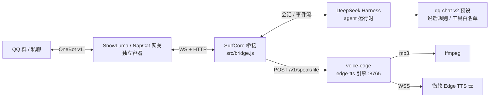

# CreateYourWhaleIn_iStore · 小鲸鱼

> 不是机器人框架，是**配置与经验仓库**：角色卡、语音方案、闸门配置、桥接补丁、踩坑记录。
> 上层跑的是 [SurfCore](https://github.com/Mieksido/surfcore)（MIT，QQ ↔ DSH 桥接 + B站/桌宠插件）
> 与 [DeepSeek Harness](https://github.com/deepseek-ai)（agent 运行时），QQ 网关用 SnowLuma / NapCat（第三方，需自己装）。

一句话：**给她一个身份、一套脾气、一张嘴**，让她在 QQ 群里像真人一样活着。

---

## 已实现

| 能力 | 状态 | 说明 |
|---|---|---|
| 🎭 群友人设 | ✅ | 小鲸鱼角色卡：短句、口语、傲娇、会潜水会摸鱼、去 AI 味黑名单 |
| 🗣️ 语音条 | ✅ v0.1.0 | edge-tts 引擎（免费），口语稿、40 字内、1~3 条短语音、语气标记、语音库短语气 |
| 💬 B站评论 | ✅ v0.1.0 | 放开「桥接工具白名单」+「插件 autoComment / dmMode」两道闸 |
| 🛡️ 安全闸门 | ✅ | 语音仅主人触发、2 条/分钟、10 条/小时；B站每轮最多 1 条评论 |
| 🐋 群聊节奏 | ✅ | 分条发送、按概率插话、潜水/唤醒、收尾判断（由 SurfCore 提供） |

## 架构



关键设计：**桥接只认一个 HTTP 契约**（`POST /v1/speak/file`），所以语音引擎可换（Edge / 火山 / CosyVoice / 本地），桥接零改动。
详见 [docs/architecture.md](docs/architecture.md)、[docs/voice.md](docs/voice.md)。

## 目录

```
persona/          示例人格卡 + 说明（**真实人格卡不入库**，见 persona/README.md）
preset/           qq-chat-v2 预设里的语音规则，可直接贴回 SurfCore
deploy/
  voice-edge/     voxd 契约的 edge-tts 引擎（server.py / start.sh / cron 兜底）
  patches/        SurfCore 桥接的本地补丁（跨容器 record base64）
  apply_config.py 一键写配置（语音 + B站评论 + 工具白名单，带备份、幂等）
docs/             架构、语音链路、B站评论闸门、ADR
cases/            每次改动的「现象 → 根因 → 修法 → 验证 → 回滚」记录
CHANGELOG.md      版本记录
ROADMAP.md        下一步
```

## 快速开始

1. 先按 SurfCore 的 README 装好：DSH + SurfCore 插件 + SnowLuma/NapCat，能正常收发 QQ 消息。
2. 部署语音引擎：见 [deploy/voice-edge/README.md](deploy/voice-edge/README.md)。
3. 写配置：`python3 deploy/apply_config.py --owner-qq <你的QQ> --bili-name <你的B站昵称>`。
4. 重启桥接（`POST /api/restart` 或重启容器），私聊她说句话，看她会不会发语音条。

## 安全与合规

- **人格卡不入库**：真实人格卡是私有内容，仓库只放示例。她的记忆/角色数据在另一个**私有**仓库。
- **密钥不入库**：仓库里没有 QQ 号、B站 UID、控制台令牌、网关 token、SSH 密码。配置脚本的敏感参数走命令行或本地文件。
- **个人号协议**：SnowLuma/NapCat 走非官方协议，有风控与封号风险，自负；官方机器人 API 无此问题但能力受限。
- **语音**：Edge TTS 免费、没有 SLA；它挂了不会影响聊天，只会退回打字。
- **B站评论**：真正的风险是账号风控。默认每轮最多 1 条，别急着调大。
- **不打包第三方运行时**：SnowLuma 是第三方专有软件，本仓库只写「怎么接」。

## 许可

本仓库内容（文档、脚本、示例人格卡）用 [MIT](LICENSE)。
上游 SurfCore 是 MIT；SnowLuma 是第三方专有运行时；Edge TTS 受微软服务条款约束。
